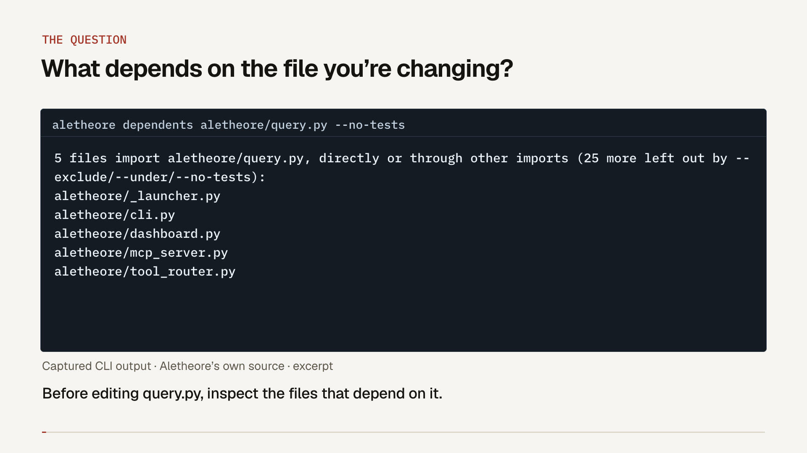

<p align="center">
  
</p>

<h3 align="center">Understand your code. Trace the impact of a change.</h3>

<p align="center">
  Scan a repository into structured evidence, inspect its dependencies and ownership,
  and give coding agents and PR reviews concrete source context.
</p>

<p align="center">
  <a href="https://pypi.org/project/aletheore/"></a>
  <a href="https://pypi.org/project/aletheore/"></a>
  <a href="LICENSE"></a>
  <a href="https://github.com/Aletheore/Aletheore/actions/workflows/tests.yml"></a>
</p>

<p align="center">
  <a href="#quickstart">Run locally</a> ·
  <a href="https://github.com/apps/aletheore/installations/new">Install the GitHub App</a> ·
  <a href="https://www.aletheore.com/#walkthrough">Watch the walkthrough</a> ·
  <a href="src/README.md">CLI reference</a>
</p>

## See the workflow

[Watch the 3-minute developer walkthrough →](https://www.aletheore.com/#walkthrough)

[](https://www.aletheore.com/#walkthrough)

Follow a scan of Aletheore's own CLI source, inspect dependencies and related tests,
then see how the evidence connects to MCP and PR review. The walkthrough separates
captured local output from explanations of hosted features.

## Quickstart

Requires **Python 3.11–3.14** and [pipx](https://pipx.pypa.io/stable/installation/).
Run these commands from a repository you want to inspect:

```bash
pipx install aletheore
aletheore scan .
aletheore query hotspots
aletheore dashboard .
```

Open the dashboard at the local URL printed in your terminal. The scan writes
`.aletheore/air.json`, a compact `.aletheore/air.toon`, and history snapshots.
The deterministic scanner does not call an LLM. Local scanning and structural queries
need no Aletheore account or model API key. Registry lookups and optional scanner integrations
can use the network; see [Data and network behavior](#data-and-network-behavior).

Already installed? Update with `pipx upgrade aletheore`.
For a virtual environment or source installation, see the [setup guide](src/README.md#setup).

## Start with a question

Run a scan first. Replace the example paths and symbol with names from your repository.

| What you need to know | Command |
| --- | --- |
| Where is a function defined? | `aletheore locate find_ownership` |
| Who imports this file, directly or indirectly? | `aletheore dependents src/example.py` |
| Where is this symbol referenced? | `aletheore usages parse_config` |
| Which tests are related to this file? | `aletheore tests-for src/example.py` |
| Which files change frequently? | `aletheore query hotspots` |
| Who has contributed to a file? | `aletheore query ownership src/example.py` |
| Which endpoints are mapped? | `aletheore query endpoints` |
| Which secret findings need review? | `aletheore query secrets` |
| Are there circular imports? | `aletheore cycles` |

`dependents` follows resolved import edges. `tests-for` identifies candidates from import
relationships and naming conventions; it does not execute tests or establish coverage.
Ownership reflects Git history, rather than an assignment of responsibility.
Use `aletheore query` to list available query kinds and `aletheore COMMAND --help` for options.

## Give your coding agent repository evidence

```bash
aletheore mcp-install . --target cursor
```

This writes client configuration so Cursor can launch the repository's MCP server.
Restart or reload the client as needed. Other supported targets include Claude Code,
VS Code, Kiro, Opencode, Antigravity, Codex CLI, and Claude Desktop; list the current
options with `aletheore mcp-install --help`.

An agent can inspect symbols, imports, dependents, owners, endpoints, and related evidence
without starting each investigation from an unstructured repository dump.
For example, ask your agent:

> Before changing this function, use Aletheore to locate its definition, inspect its
> references and import dependents, and identify candidate tests. Cite the evidence and
> distinguish resolved relationships from uncertainty.

For clients you configure manually, the server command is `aletheore mcp .`.
Optional AI answering, semantic indexing, and external tools have their own setup and
network requirements. See the [MCP guide](src/README.md#aletheore-mcp-path).

## What you can use

| Surface | Purpose | Start here |
| --- | --- | --- |
| Local CLI | Scan, locate code, inspect risks, and compare evidence | `aletheore scan .` |
| Local dashboard | Explore dependency and cluster graphs and scan history | `aletheore dashboard .` |
| MCP server | Let a coding agent query repository evidence | `aletheore mcp-install --help` |
| AI audit | Generate a report using a configured coding-agent CLI or API provider | `aletheore audit --help` |
| Hallbook | Search the bundled coding-agent skill catalog | `aletheore hallbook search "code review"` |
| Agent context tools | Measure context overhead and inspect optional tool profiles | `aletheore tokens --help` |
| GitHub Action | Report new and resolved findings between a PR's base and head | [Action setup](#run-in-github-actions) |
| Hosted GitHub App | Run PR reviews and use managed repository features | [Install the app](https://github.com/apps/aletheore/installations/new) |

Hallbook skills have individual instructions, dependencies, and licenses; review a skill
before installing or executing it. Token auditing can invoke your configured agent;
context profiles are optional and change which tools that agent can access.

## Review changes in GitHub

The hosted GitHub App adds PR reviews, managed audits, AIRview architecture pages,
AI-marked symbol documentation, and endpoint monitoring with source context.
Availability depends on the selected plan. Free AI reviews are globally rate-limited and
subject to availability. See [current plans and limits](https://www.aletheore.com/pricing)
rather than relying on a price copied into this README.

[Install the Aletheore GitHub App](https://github.com/apps/aletheore/installations/new)
and choose the repositories to connect.

### Run in GitHub Actions

For a deterministic PR diff in your own workflow:

```yaml
name: Aletheore
on: [pull_request]

permissions:
  contents: read
  pull-requests: write

jobs:
  evidence:
    runs-on: ubuntu-latest
    steps:
      - uses: Aletheore/Aletheore@v0.10.2
        with:
          fail-on-new-secrets: true
```

The Action scans both refs and reports new/resolved secrets, dependency vulnerabilities,
and layer-convention violations. It runs `scan` and `diff`, rather than an AI audit.
The example pins an existing release; review and pin a commit SHA for your own deployment
policy. Fork PRs can have read-only tokens: comment posting may be unavailable even when
analysis succeeds. See [Action inputs](action.yml) and the [CLI reference](src/README.md).

## What the scanner understands

Dependency graphs support **Python, JavaScript/JSX, TypeScript/TSX, Go, Rust, Java, Kotlin,
Ruby, PHP, C, C++, C#, and Swift**, with language-specific resolution limits.
Secrets and Git analysis can still apply to other source files.
Dependency checks depend on supported manifests, resolved versions, and registry coverage.

The evidence can include imports, symbols, clusters, Git ownership and activity,
secret findings, dependency vulnerabilities and licenses, static analysis, endpoints,
database schema, infrastructure, and error handling. Some checks depend on installed
external scanners or explicit configuration. Missing tools and unsupported analysis
must be distinguished from a clean result.

Static evidence is a starting point for investigation. Dynamic dispatch, runtime configuration,
external services, and unresolved imports can leave gaps. A source citation makes a claim
inspectable; it does not by itself prove that a bug exists or that a change is safe.
Read [resolution details and configuration](src/README.md) for the limits that apply to your language.

## Data and network behavior

The local deterministic scan builds evidence on your machine. Its network behavior depends
on enabled checks and integrations:

- Dependency vulnerability and license checks contact OSV and package registries.
- Semgrep can fetch rules and send its own metrics; optional integrations such as SonarQube
  have separate submission behavior.
- CLI startup can check PyPI for updates. Set `ALETHEORE_NO_UPDATE_CHECK=1` to disable that check.
- Crash reporting is enabled by default and can be disabled with
  `aletheore config crash-reporting off` or `ALETHEORE_CRASH_REPORTING=0`.
- AI audits, hosted features, and configured semantic services send the context required
  by the selected workflow to their configured services. Local evidence can contain
  sensitive metadata or source excerpts; review it before sharing.

To skip registry and static-scanner checks for a local scan:

```bash
aletheore scan . --no-check-vulnerabilities --no-check-licenses --no-check-static-analysis
```

These scan flags do not configure every other command or service. Review
[CLI configuration and crash reporting](src/README.md#crash-reporting),
[security information](SECURITY.md), and the hosted [privacy policy](https://www.aletheore.com/privacy)
for the workflow you choose.

## Evidence and benchmarks

Explore [published scan examples](https://www.aletheore.com/dogfooding) and
[benchmarks with methodology and limits](https://www.aletheore.com/benchmarks).
The separate [benchmark repository](https://github.com/Aletheore/aletheore-benchmarks)
contains the PR-review evaluation harness. Results depend on repository, task, model,
and sample; they do not guarantee the same result on your code.

## Contribute or get help

- [Report a bug or request a feature](https://github.com/Aletheore/Aletheore/issues).
- Read [CONTRIBUTING.md](CONTRIBUTING.md) to work on the project.
- Use [SECURITY.md](SECURITY.md) for vulnerability reports.
- [Sponsor development](https://github.com/sponsors/ArihantK15).

| Directory | Contents |
| --- | --- |
| [`src/`](src/) | CLI implementation and command reference |
| [`github-app/`](github-app/) | Hosted application, workers, and operations documentation |
| [`site/`](site/) | Next.js marketing site |
| [`docs/operations/`](docs/operations/) | Operational baselines and runbooks |
| [`benchmarks/`](benchmarks/) | Repository benchmark material |

## Licensing


Aletheore is open source under the [GNU Affero General Public License v3.0](LICENSE)
(AGPL-3.0). You can use, study, modify, and redistribute it, including at a company and
for internal tooling, as long as you follow the AGPL. The part that matters most:

- If you modify Aletheore and convey that covered work, or provide it for network interaction in
  circumstances covered by AGPL section 13, follow the AGPL's corresponding-source and notice
  requirements for the covered work.
- Independent code and separate components may remain under their own licenses; whether a
  combination is a covered work depends on the AGPL and the facts of the distribution.
- Running the unmodified CLI or Action on your own code does not put your code under the AGPL.

If those terms don't fit, for example you want to embed Aletheore in a closed-source product
or run a modified version as a service without publishing it, a commercial license is
available. See [COMMERCIAL-LICENSE.md](COMMERCIAL-LICENSE.md), or email
[arihantkaul@outlook.com](mailto:arihantkaul@outlook.com). The hosted, paid tier is
[Aletheore AIR](https://aletheore.com).

Copyright (C) 2026 Arihant Kaul. See [NOTICE](NOTICE).

Releases through 0.8.12 were Apache 2.0, and 0.8.13 through the version before this change were PolyForm
Noncommercial 1.0.0. Copies you already received keep the license they came with.
